# Diagrams and Lifecycles

The pictures of this project: what exists in the repository, how the runtime is put together, how the account, relation, SOS, and service lifecycles move through their states, and how work itself moves through the phases. Every diagram is drawn from requirements that are written elsewhere — this document adds no rules of its own.

Owner: Engineering. Reviewed: 2026-10-18.

## 1. How these diagrams are maintained

- **Derived, never normative.** The requirement text and the document that governs a subject win; a diagram that disagrees with them is a defect, fixed in the same change as the text it contradicts ([GOV-42](development/00-repository-conventions.md) §1).
- **Mermaid source, rendered by GitHub.** Each block is plain text, so it is reviewed, diffed, and linked like the rest of the pack. It also reads acceptably in a terminal, which is where agents without a renderer will meet it.
- **Every diagram names its requirements.** The line above each block is a `Cited:` line: an unlabelled picture cannot be checked, and it is not evidence.
- **The declared state machines are cross-checked.** §9 lists the four state vocabularies that are declared in the documents governing them. The documentation gate ([QA-118](development/03-ci-and-gates.md) §3) extracts the states from the sentence that declares them, compares them with §9, requires each one to be drawn in the section §9 names, and fails otherwise — so neither the table, nor the section reference, nor the picture can drift while the prose stays correct.
- **Syntax is verified when the diagram is authored**, not assumed: every block in this file parsed with Mermaid 12.2.0 on 2026-10-14 (recorded in [REFERENCES](REFERENCES.md) and the [review record](development/08-phase-0-review.md) §14). Parsing stays an authoring step rather than a CI gate: the documentation gate is dependency-free by design and runs the structural checks only ([CI and gates](development/03-ci-and-gates.md) §3), so a diagram that changes is re-parsed by the change that edits it, with the parser version recorded there.

## 2. The repository after Phase 1

Cited: `GOV-41` … `GOV-48`, `OPS-28` … `OPS-43`, `OPS-88`, `OPS-89`, `ADR-010`, `ADR-029`.

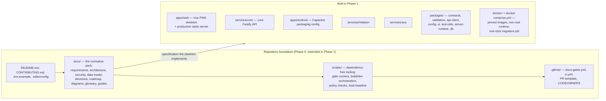

Package dependency directions are acyclic and enforced by an automated check, not by review alone (`OPS-40`) — the check runs with the packages (`scripts/check-deps.mjs`); server implementation code never reaches the frontend and frontend code never reaches a service (`OPS-41`).

## 3. System topology and data ownership

Cited: `OPS-01` … `OPS-09`, `OPS-11` … `OPS-19`, `OPS-80`, `PLG-36` … `PLG-39`.

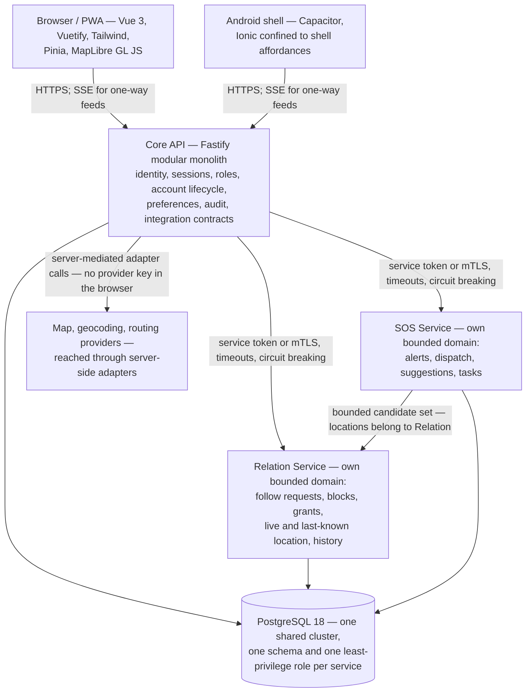

Provider work is reached through the core API's adapter group (`/geo/*` and `/routes/*`, delivered in Phase 3 and Phase 6), which keeps provider keys and personal identity server-side (`MAP-18`, `MAP-19`); which provider that is remains [Q-10](DECISIONS.md#open-questions).

Constraints the picture leaves out because they are rules, not shapes: a service never reads another service's tables (`OPS-16`, `OPS-18`); one PostgreSQL cluster may be shared, but no table is (`OPS-17`); a service outage degrades features and never breaks sign-in (`OPS-15`, `PLG-40`); one replica per service until shared state exists (`ADR-008`); the SOS Service applies the category filter inside its own process, over a bounded candidate set (`OPS-80`); and where cross-service delivery must be reliable it uses an outbox table — the one defined today belongs to the SOS Service schema, and its consumers are idempotent (`OPS-19`, `DATA_MODEL`).

## 4. The request path, from route to policy

Cited: `UI-01` … `UI-07`, `ADM-02`, `SEC-21` … `SEC-27`, `AUTH-31` … `AUTH-34`, `DATA-10`, `OPS-59`, `OPS-60`.

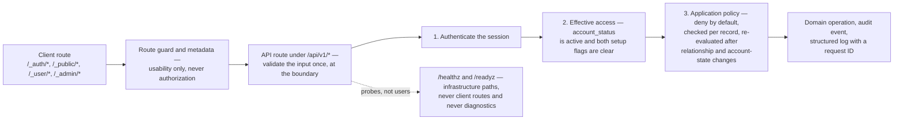

## 5. Authentication and account lifecycles

### 5.1 Account states

Cited: `AUTH-27`, `AUTH-28`, `AUTH-31` … `AUTH-38`, `DATA-10`.

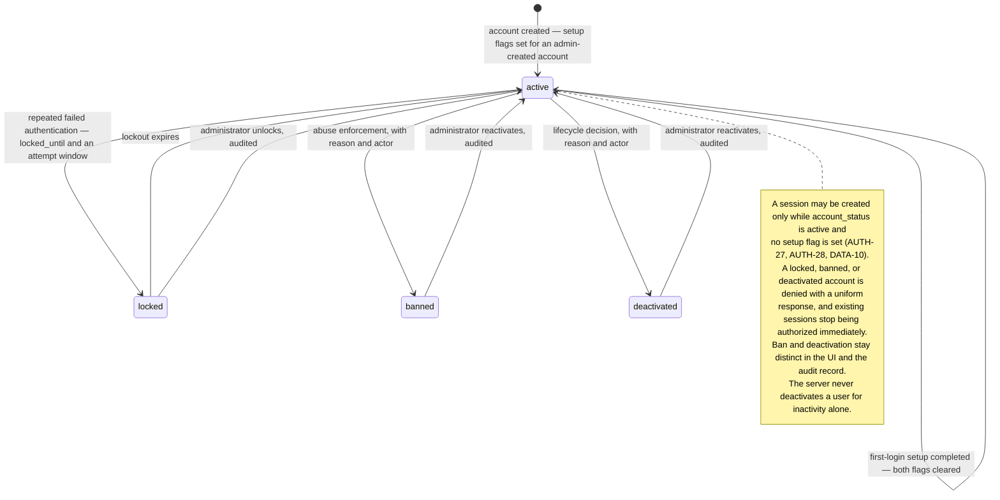

### 5.2 Password recovery

Cited: `AUTH-13` … `AUTH-20`, `DATA-09`, `SEC-07`, `SEC-12`.

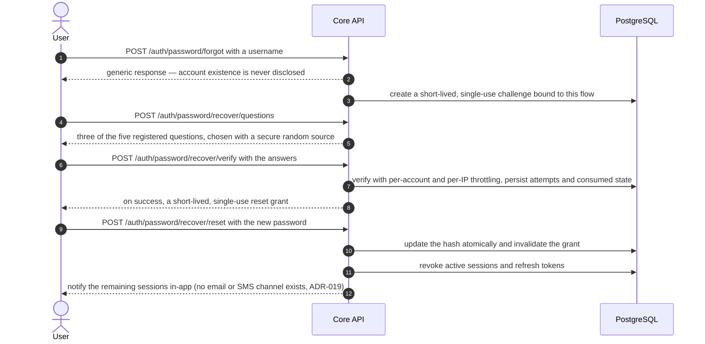

Sessions end on logout, password change, password reset, and administrative state change (`AUTH-18`, `AUTH-24`, `AUTH-34`); the session model is [ADR-021](DECISIONS.md#adr-021--bearer-access-tokens-with-rotating-refresh-tokens-for-web-and-android) — short-lived bearer access tokens with rotating refresh tokens — and revocation is server-side whichever transport carries them (`AUTH-06`).

## 6. Relation lifecycles

### 6.1 Requests, relationships, and blocking

Cited: `REL-01` … `REL-06`, `DATA-02`, `DATA-03`, `DATA-12`, `SEC-27`.

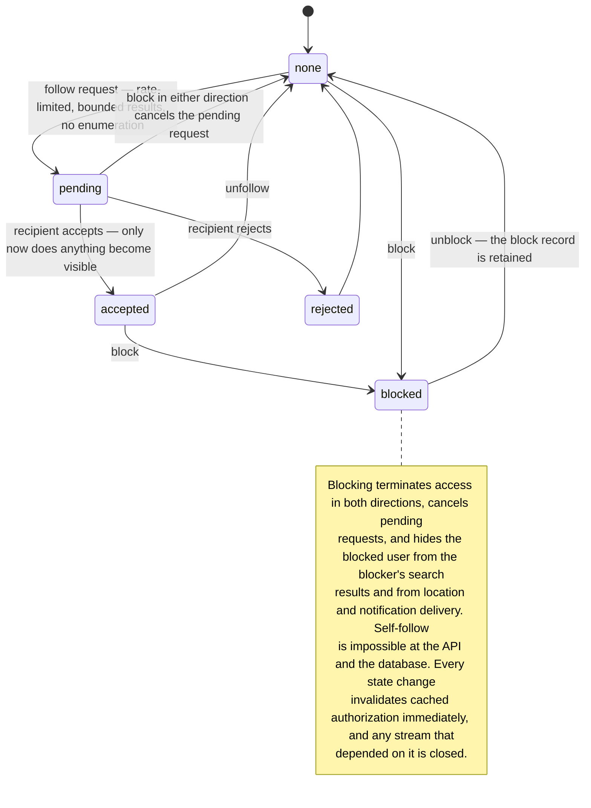

### 6.2 Live location: one grant per follower

Cited: `MAP-07` … `MAP-10`, `PRIV-01` … `PRIV-05`, `PRIV-23`, `REL-07` … `REL-11`, `REL-13`, `DATA-16`, `DATA-18`, `OPS-24`, `OPS-27`, `ADR-013`.

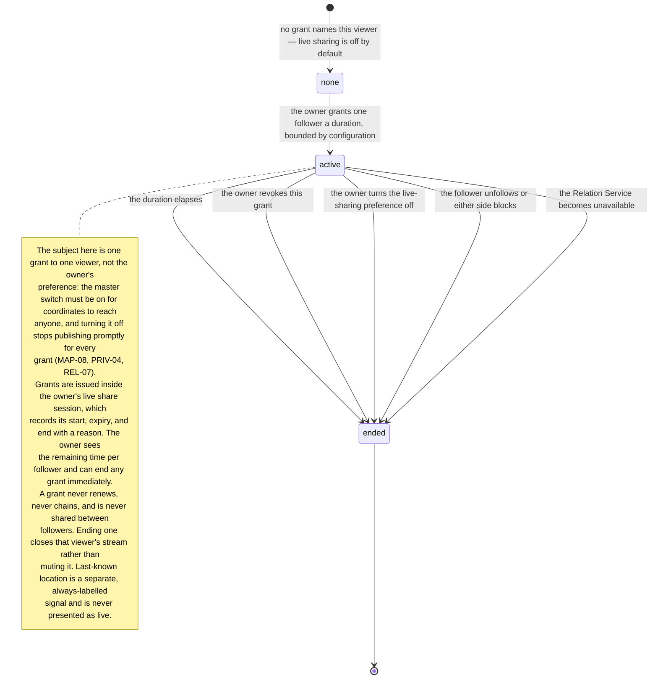

### 6.3 Location history: opt-in, retention-bounded, deletable

Cited: `MAP-22`, `REL-12`, `REL-14`, `PRIV-24`, `PRIV-25`, `DATA-17`, `DATA-26`, `OPS-50`, `ADR-014`, `ADR-026`.

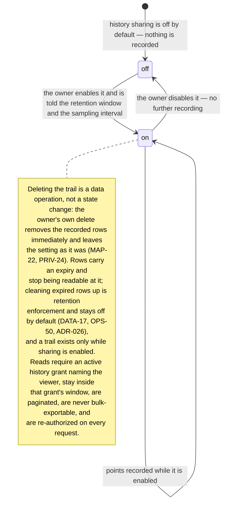

## 7. SOS lifecycle

### 7.1 From alert to resolution

Cited: `SOS-01` … `SOS-15`, `SOS-24` … `SOS-29`, `DATA-19` … `DATA-21`, `DATA-25`, `OPS-12`, `OPS-80`.

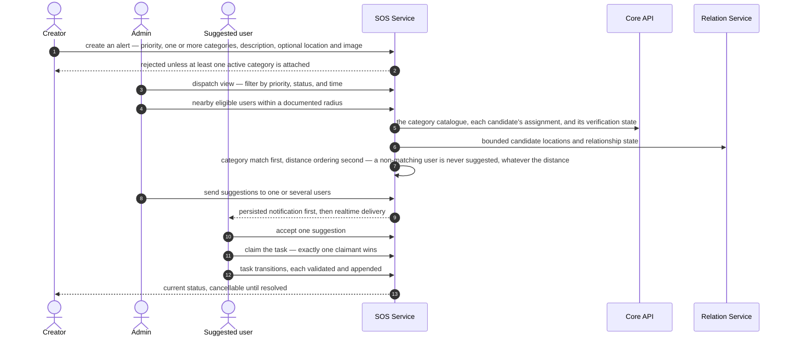

### 7.2 Suggestion states

Cited: `SOS-09` … `SOS-15`, `SOS-25`.

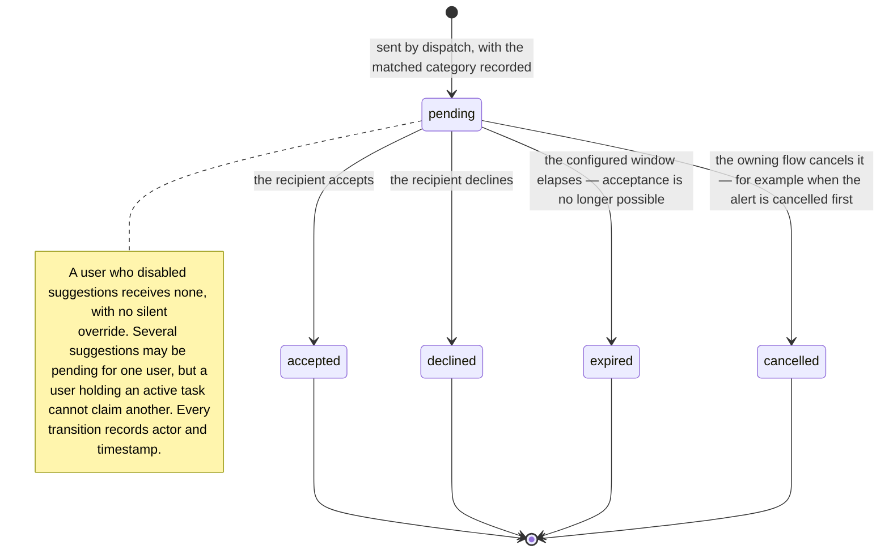

### 7.3 Task states

Cited: `SOS-13`, `SOS-14`, `SOS-16` … `SOS-20`, `DATA-06` … `DATA-08`.

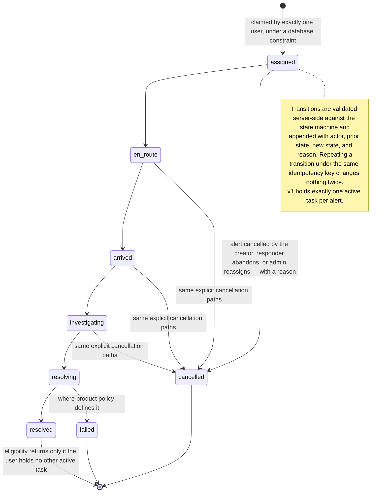

## 8. Operator service release lifecycle

Cited: `PLG-15` … `PLG-28`, `PLG-43` … `PLG-46`, `PLG-50`, `DATA-11`, `ADR-030`.

```mermaid
stateDiagram-v2
  [*] --> built : reviewed selected source and locked dependencies
  built --> verified : isolated build and contract tests pass
  verified --> staged : operator stages isolated workload
  staged --> active : readiness and approval pass
  active --> disabled : revoke credentials and stop workload
  disabled --> staged : new reviewed rollout
  built --> failed : build fails
  verified --> failed : deployment fails
  staged --> failed : health or smoke checks fail
  failed --> retired : failed attempt archived; prior healthy release stays active
  disabled --> retired : preserve audit evidence and apply storage policy
  active --> retired : successful replacement and credential revocation
  retired --> [*]
```

Deployment tooling owns these evidence states. No core installation table, upload endpoint or runtime orchestration controller is implied. Phase 7 supplies the full rollout rehearsal; source export is not a claim that it is already implemented.

## 9. State vocabularies

The four machines whose states are declared outside this document: three in [PRODUCT_REQUIREMENTS](PRODUCT_REQUIREMENTS.md) (§3 and §7) and one in [SERVICE_SYSTEM](SERVICE_SYSTEM.md) §5 (operator evidence, not a core table). This table is the checked surface: the documentation gate compares each row with the sentence that declares the states, requires every one of them to appear in the section named in the last column, and fails on any disagreement ([QA-118](development/03-ci-and-gates.md) §3).

| Machine | States | Declared in | Drawn in |
| --- | --- | --- | --- |
| `account_status` | `active`, `locked`, `banned`, `deactivated` | [PRODUCT_REQUIREMENTS](PRODUCT_REQUIREMENTS.md#3-authentication-and-account-recovery) §3, `AUTH-31 … AUTH-34` | §5.1 |
| `sos_suggestions.status` | `pending`, `accepted`, `declined`, `expired`, `cancelled` | [PRODUCT_REQUIREMENTS](PRODUCT_REQUIREMENTS.md#7-sos-service) §7, `SOS-11` | §7.2 |
| `sos_tasks.status` | `assigned`, `en_route`, `arrived`, `investigating`, `resolving`, `resolved` | [PRODUCT_REQUIREMENTS](PRODUCT_REQUIREMENTS.md#task-states) §7, `SOS-16` | §7.3 |
| `service_release.status` | `built`, `verified`, `staged`, `active`, `disabled`, `failed`, `retired` | [SERVICE_SYSTEM](SERVICE_SYSTEM.md#5-service-lifecycle-and-api) §5, `PLG-15 … PLG-46` | §8 |

Two facts are deliberately not status values: an account's setup flags, which are orthogonal state (`AUTH-27`), and a task's recorded transition reason, which is metadata on the event (`SOS-17`, `SOS-20`). Adding a fifth account state, a sixth suggestion state, or an operator release state means changing the governing document first — the gate then demands the diagram and this table in the same change.

## 10. The project's own cycles

### 10.1 The phase cycle

Cited: `GOV-55`, `GOV-87`, `GOV-88`, `QA-54`, `QA-117`, [ROADMAP](ROADMAP.md).

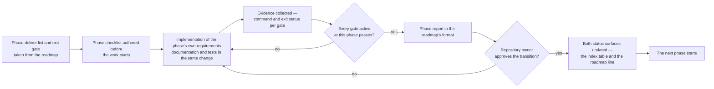

A later-phase issue that blocks the current phase does not break the sequence: it is handled as a declared pull-forward ([GOV-88](development/00-repository-conventions.md#8-phases-prioritization-and-affiliation)) — recorded with its reason, kept to the minimal slice the phase needs, and the owning phase still delivers and proves the full requirement.

### 10.2 The decision cycle

Cited: [DECISIONS](DECISIONS.md), `GOV-87`, `GOV-88`, [checklist](development/05-phase-gate-checklist.md) §7.

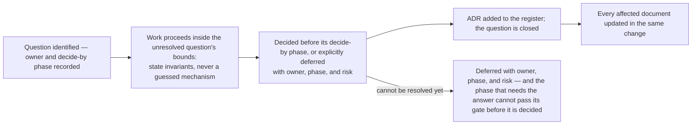

### 10.3 The documentation cycle

Cited: `GOV-42`, `GOV-71`, `GOV-72`, `QA-63`, `QA-64`, `QA-116`, `QA-118`.

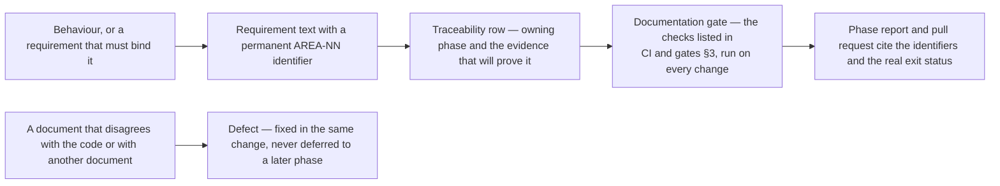

### 10.4 The release cycle

Cited: `QA-48` … `QA-54`, `QA-87` … `QA-106`, [release plan](development/06-release-plan.md) §3.

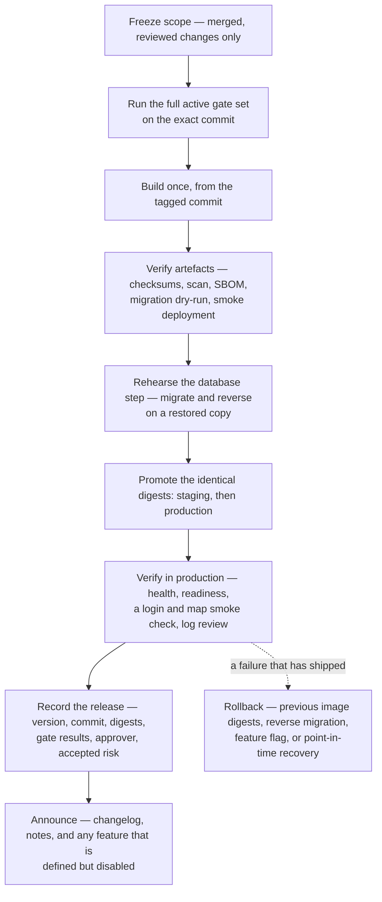

A release that fails before promotion is simply not released; the rollback paths (`QA-92 … QA-95`) are for what has already shipped.

The cycles above are the reason this repository can be worked on by more than one person, or by an agent, without hidden state: every loop ends by writing down what happened, with the command that proved it.
